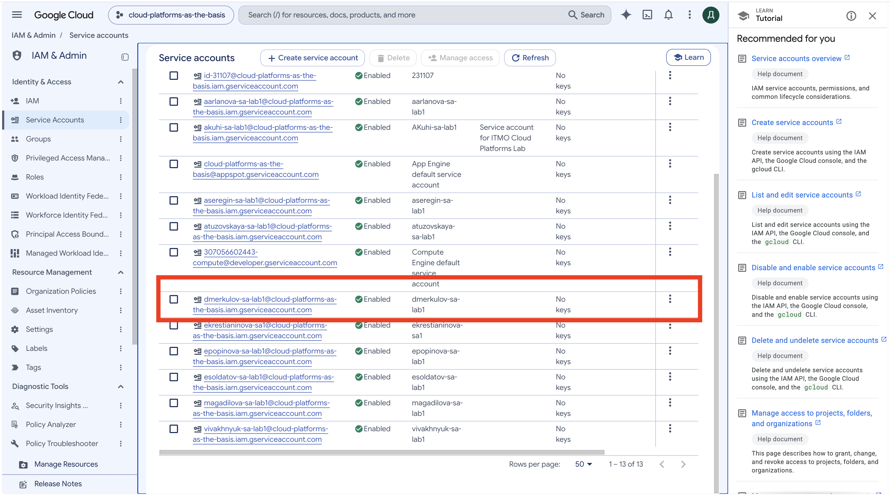
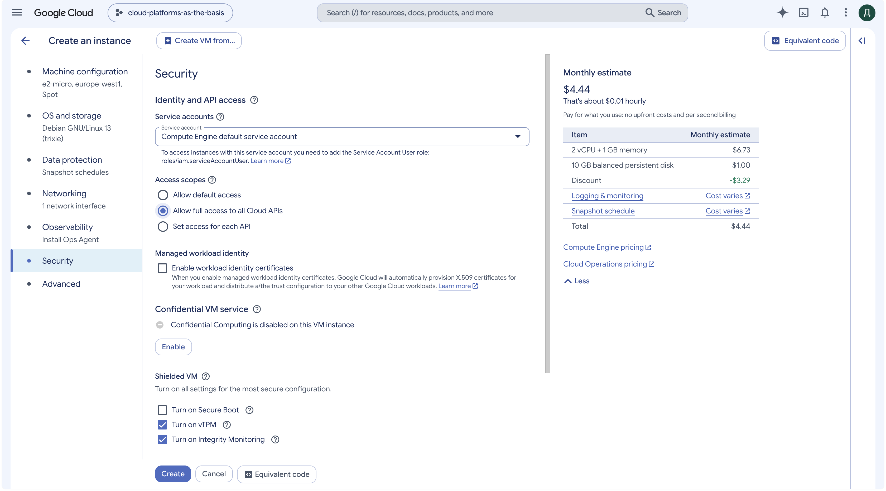
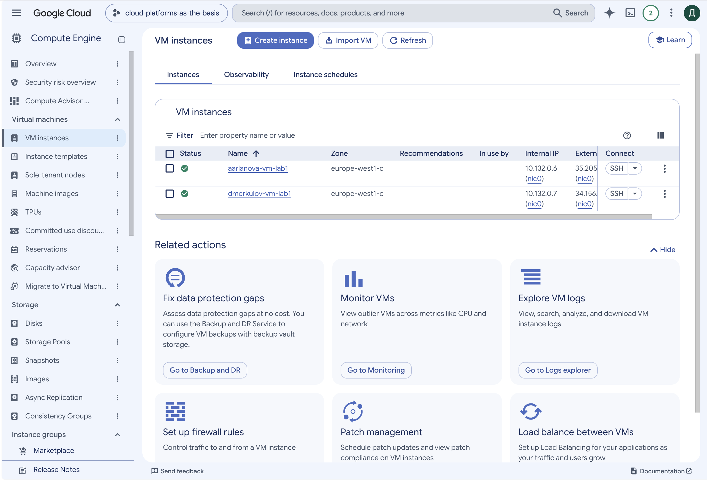
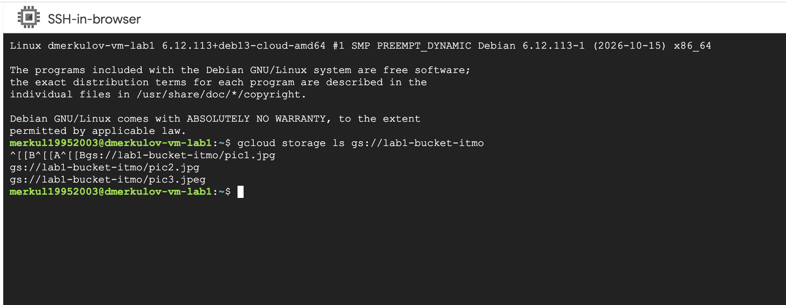
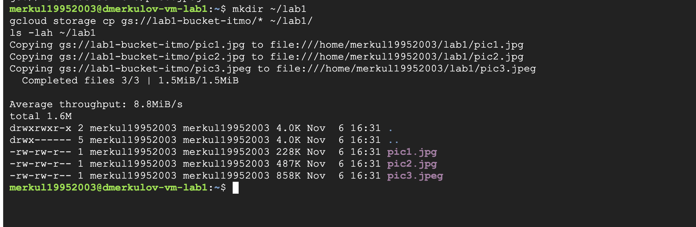
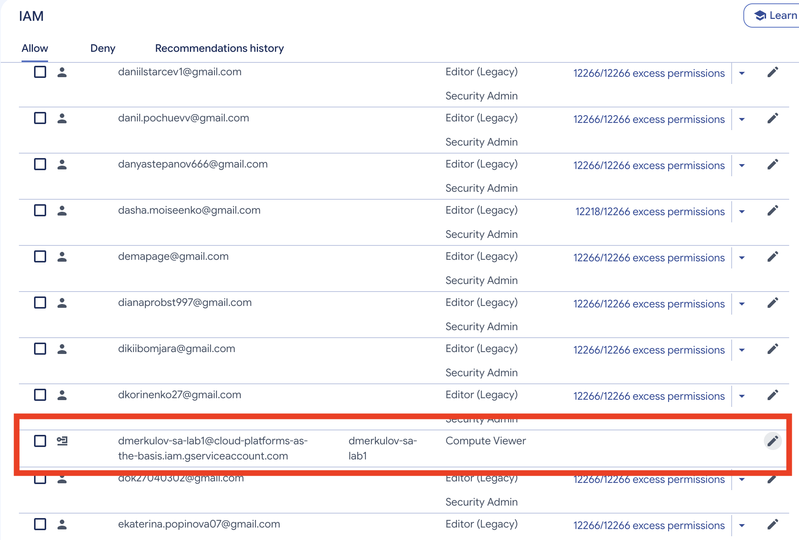
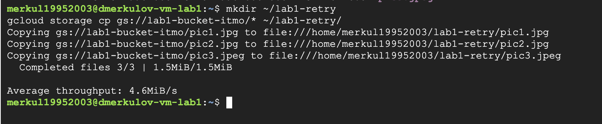
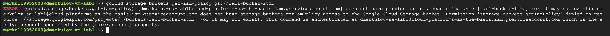
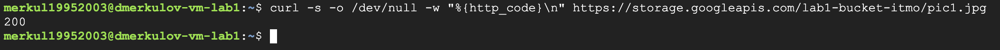
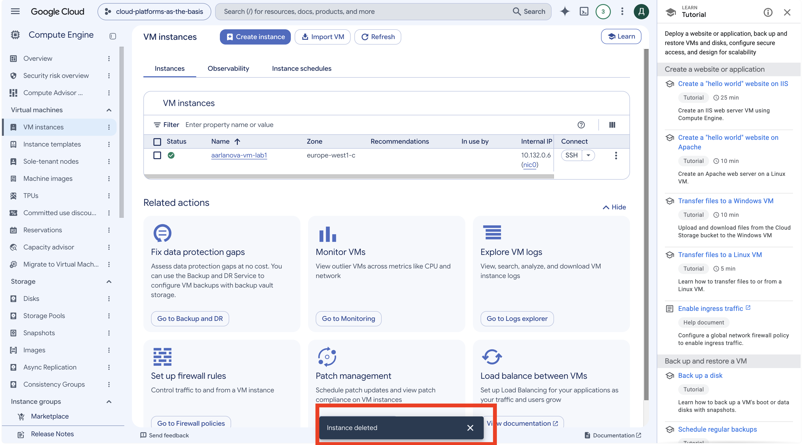

University: [ITMO University](https://itmo.ru/ru/)
Faculty: [FICT](https://fict.itmo.ru)
Course: [Cloud platforms as the basis of technology entrepreneurship](https://github.com/itmo-ict-faculty/cloud-platforms-as-the-basis-of-technology-entrepreneurship)
Year: 2025/2026
Group: U4125
Author: Merkulov Daniil Vyacheslavovich
Lab: Lab1
Date of create: 06.11.2026
Date of finished: [указать после защиты]

## Цель работы

Ознакомиться с основными возможностями и преимуществами облачной платформы Google Cloud.

## Ход работы

### 1. Доступ к проекту

Заполнил гугл-форму с почтой, после чего получил доступ к учебному проекту `cloud-platforms-as-the-basis`.

Здесь же поймал первое препятствие: Google с марта 2026 требует двухэтапную аутентификацию для входа в консоль, без нее показывает страницу «Google Cloud access blocked». Включил двухэтапную проверку в настройках аккаунта, после этого консоль открылась.

### 2. Сервисный аккаунт

Создал сервисный аккаунт `dmerkulov-sa-lab1` с ролью **Storage Admin**.

Сервисный аккаунт это учетная запись не для человека, а для программы или виртуальной машины. У него нет пароля, вместо этого он получает токен, и все обращения к ресурсам идут от его имени. Удобно тем, что права выдаются не живому человеку, а конкретной машине, и их можно в любой момент поменять.



### 3. Виртуальная машина

Создал виртуальную машину `dmerkulov-vm-lab1`:

- Тип машины: **e2-micro**, это минимальная конфигурация
- Регион: `europe-west1`
- Модель подготовки: **Spot**
- Сервисный аккаунт: `dmerkulov-sa-lab1`, доступ ко всем Cloud API

Про Spot отдельно. Это машина на «лишних» мощностях Google: стоит примерно в три раза дешевле обычной, но Google может ее выключить в любой момент, если мощности понадобятся другим. Для учебной задачи или фоновой обработки подходит, для боевого сервиса нет.

Важный момент, которого нет в задании: по умолчанию машина создается от дефолтного сервисного аккаунта Compute Engine. Я специально указал свой, иначе пятый пункт работы не имел бы смысла, потому что машина ходила бы в хранилище не от того аккаунта, у которого мы потом меняем права.





### 4. Копирование файлов из бакета

Подключился к машине по SSH прямо из браузера и посмотрел, что лежит в учебном бакете:

```bash
gcloud storage ls gs://lab1-bucket-itmo
```

В бакете оказалось три файла: `pic1.jpg`, `pic2.jpg`, `pic3.jpeg`.



Создал папку и скопировал файлы:

```bash
mkdir ~/lab1
gcloud storage cp gs://lab1-bucket-itmo/* ~/lab1/
ls -lah ~/lab1
```

Все три файла скопировались, общий объем 1.5 МБ.



### 5. Смена прав доступа

Поменял роль сервисного аккаунта со **Storage Admin** на **Compute Viewer** и повторил копирование.



Ожидал получить отказ, но файлы скопировались снова.



Подождал несколько минут на случай, если права применяются не сразу, повторил, результат тот же. Значит дело не в задержке.

Проверил, точно ли роль сменилась. Запросил права самого бакета:

```bash
gcloud storage buckets get-iam-policy gs://lab1-bucket-itmo
```

Получил отказ: `storage.buckets.getIamPolicy denied`. То есть роль действительно снялась, прав администратора у аккаунта больше нет.



Оставалось понять, откуда тогда берется доступ к файлам. Обратился к файлу вообще без авторизации:

```bash
curl -s -o /dev/null -w "%{http_code}\n" https://storage.googleapis.com/lab1-bucket-itmo/pic1.jpg
```

Ответ **200**. Бакет открыт публично, его файлы читаются кем угодно даже без входа в Google.



### Выводы по пятому пункту

Права в Google Cloud назначаются на двух уровнях, и они складываются, а не заменяют друг друга:

- **Роль аккаунта** говорит, что этому аккаунту разрешено делать в проекте
- **Права самого ресурса** говорят, кому разрешено обращаться к конкретному бакету

Смена роли со Storage Admin на Compute Viewer отобрала у аккаунта административные действия, что и подтвердил отказ при запросе прав бакета. Но чтение файлов осталось, потому что на уровне бакета доступ открыт всем.

Практический вывод: чтобы закрыть доступ к данным, менять роль аккаунта недостаточно, нужно проверять и настройки самого ресурса. Иначе получается ситуация, когда формально права урезали, а данные по-прежнему лежат в открытом виде.

Заодно понятно, зачем в Compute Viewer не входит работа с хранилищем. Это роль для просмотра виртуальных машин, и к файлам она отношения не имеет. Принцип называется «минимальные необходимые права»: аккаунту выдают ровно то, что нужно для его задачи, и ничего сверху.

### 6. Удаление ресурсов

Удалил виртуальную машину и сервисный аккаунт, чтобы не тратить ресурсы проекта.



## Что нового узнал

**IAM** это система управления доступом в Google Cloud. Отвечает на вопрос, кто и что может делать с ресурсами. Состоит из трех частей: кто (пользователь или сервисный аккаунт), что разрешено (роль), и к чему (ресурс).

**Сервисный аккаунт** это учетная запись для программ, а не для людей.

**Compute Engine** это виртуальные машины, обычные компьютеры в облаке, которые можно создать за минуту и удалить, когда не нужны.

**Cloud Storage** это объектное хранилище. Файлы лежат не в папках на диске, а объектами в бакетах, и доступ к каждому можно настроить отдельно.

**Spot-машины** дешевле обычных, но Google может их выключить в любой момент.

## Вывод

Собрал базовую связку из трех сервисов: сервисный аккаунт выдает права, виртуальная машина работает от его имени, хранилище отдает файлы.

Главное, что вынес из работы: доступ в облаке это не один переключатель. Я поменял роль аккаунта и ожидал, что копирование сломается, а оно продолжило работать, потому что у самого бакета свои настройки доступа. Разобраться помогло то, что я не поверил результату на слово, а проверил, действительно ли сменилась роль, и обратился к файлу без авторизации.
