University: [ITMO University](https://itmo.ru/ru/)
Faculty: [FICT](https://fict.itmo.ru)
Course: [Cloud platforms as the basis of technology entrepreneurship](https://github.com/itmo-ict-faculty/cloud-platforms-as-the-basis-of-technology-entrepreneurship)
Year: 2025/2026
Group: U4125
Author: Merkulov Daniil Vyacheslavovich
Lab: Lab2
Date of create: 06.11.2026
Date of finished: [указать после защиты]

## Цель работы

Ознакомиться с работой Cloud Run.

## Что такое Cloud Run

Cloud Run запускает контейнеры и сам решает, сколько их нужно. Я отдаю готовый образ контейнера, Cloud Run выдает публичный адрес и дальше следит за нагрузкой: пришел запрос, поднял контейнер, запросов нет, погасил.

Отличие от виртуальной машины из первой лабораторной существенное. Машина работает круглосуточно, и платишь за время ее работы независимо от того, обращается к ней кто-нибудь или нет. Cloud Run платится по факту запросов, а в простое не стоит ничего. Такой подход называют бессерверным: сервер, конечно, есть, но меня он не касается.

## Ход работы

### 1. Создание сервиса

Создал сервис `dmerkulov-run-lab2` из готового образа `hello`, который предлагает сама платформа.

Настройки:

- Регион: `europe-west1`
- Доступ: публичный, без аутентификации, иначе ссылка не открылась бы в браузере
- Память: **512 МиБ**, процессор: **1**
- Минимум экземпляров: **0**, максимум: **1**

Минимум ноль означает, что в простое не работает ни одного контейнера. Это дешево, но первый запрос после паузы идет дольше: контейнер нужно сначала поднять. Это называется холодный старт. Если поставить минимум единицу, один контейнер всегда наготове, но и платить придется постоянно.

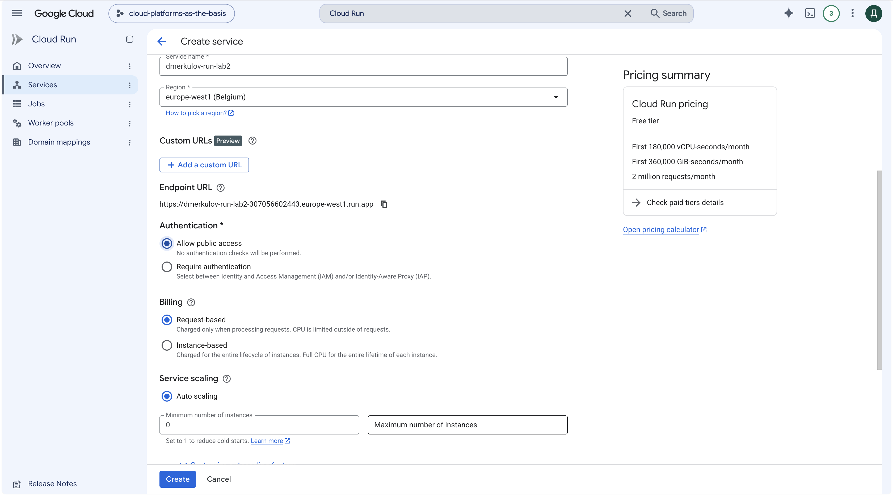

Сервис развернулся за несколько секунд, создалась ревизия `00001-djh`, на нее ушло 100% трафика.

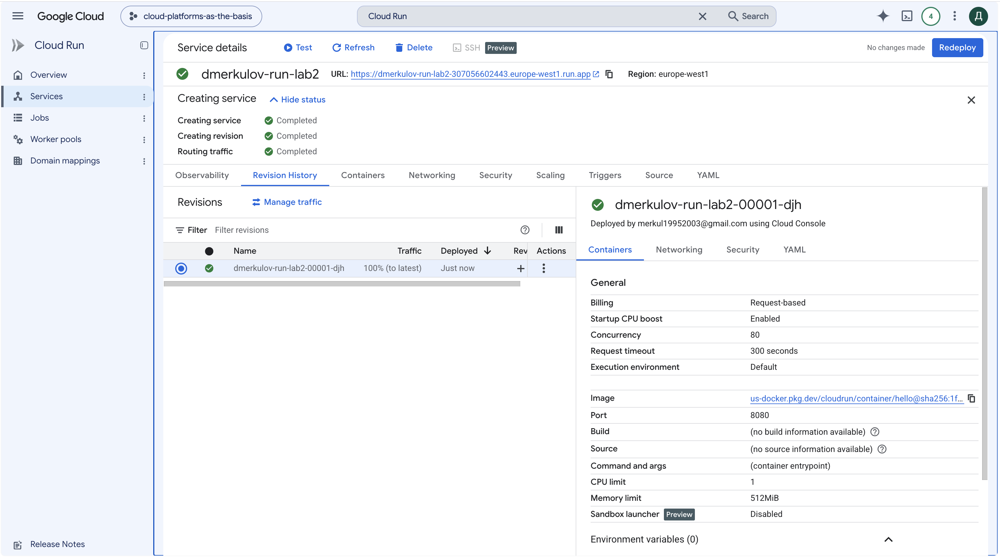

### 2. Проверка работы

Перешел по выданной ссылке, страница открылась.

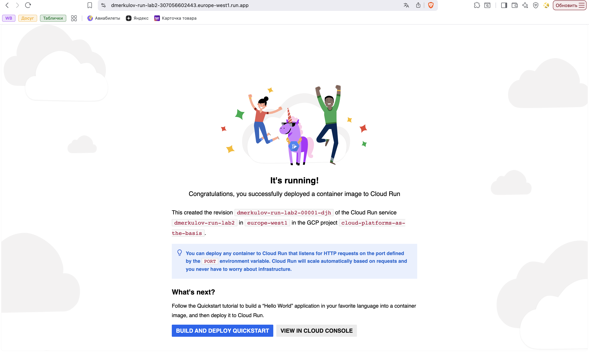

### 3. Логи и метрики

В разделе **Observability** лежат метрики и логи.

В метриках: количество запросов, время ответа, количество экземпляров контейнера. Последний график показателен: до запросов экземпляров ноль, после обращения появляется один.

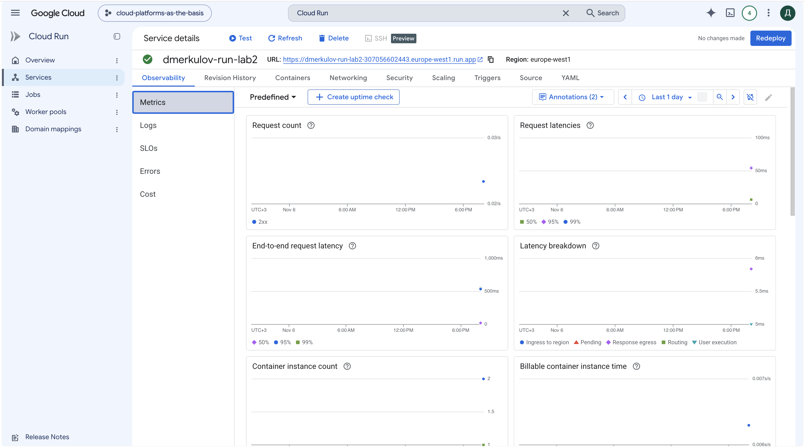

В логах видно всю жизнь сервиса. Сначала строки о создании, потом `Starting new instance. Reason: AUTOSCALING`, затем `The container started successfully and is listening for HTTP requests on port 8080`, и дальше мои запросы с кодом 200 и временем ответа 2-9 мс.

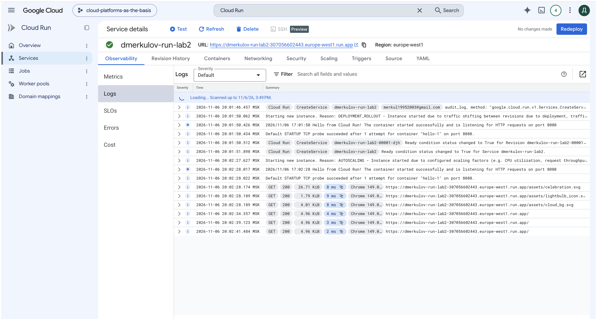

Отдельно отмечу строку про автомасштабирование: Cloud Run сам запустил контейнер, потому что пришел запрос, я ничего для этого не делал.

### 4. Смена порта на 8090

Поменял порт контейнера с 8080 на 8090 и развернул новую ревизию.

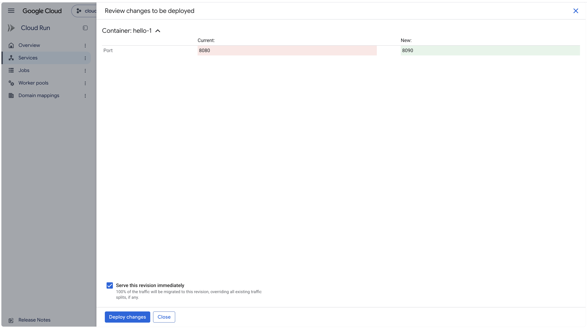

Ожидал, что сервис сломается: контейнер слушает 8080, а стучаться к нему будут в 8090. На практике ревизия `00002-8q8` поднялась и заработала.

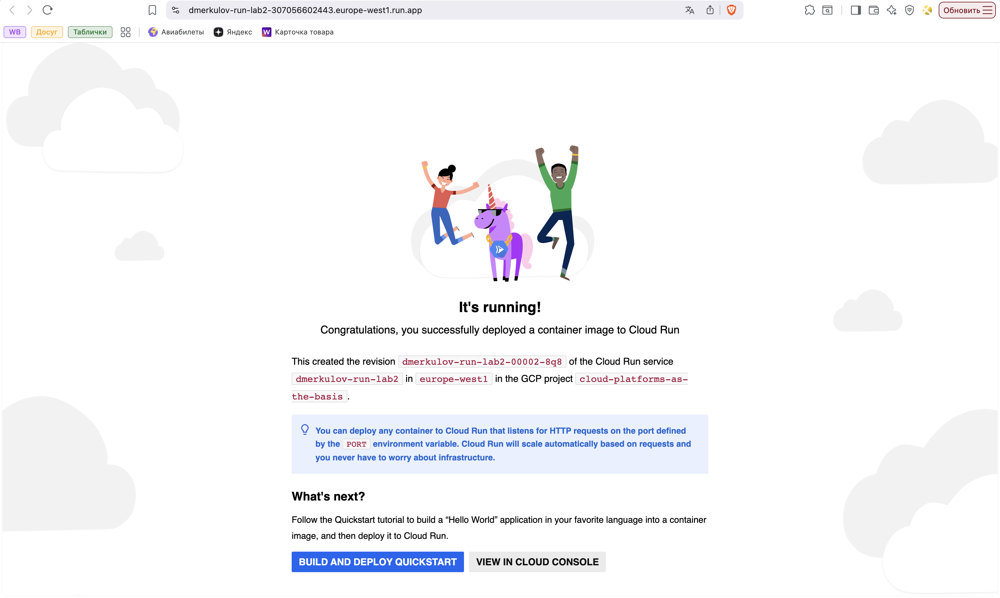

Разобрался в логах. Там видно обе ревизии подряд: сначала `listening for HTTP requests on port 8080`, после обновления `listening for HTTP requests on port 8090`.

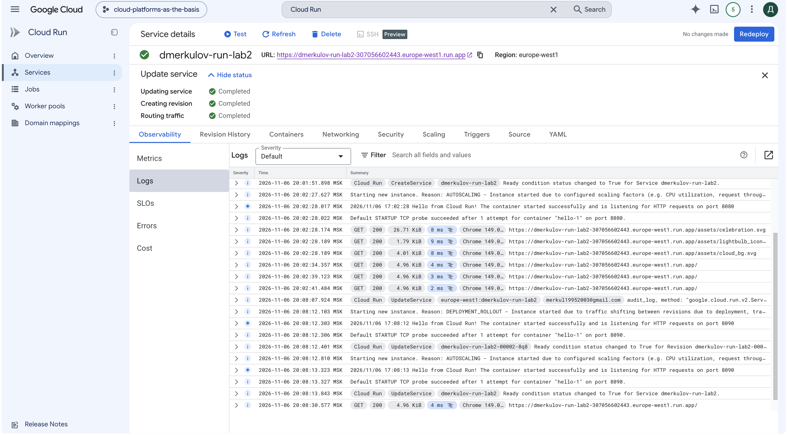

Причина в том, что контейнер не держит порт жестко прописанным в коде. Cloud Run передает ему номер порта в переменной окружения `PORT`, а контейнер читает ее и встает на тот порт, который сказали. Об этом прямо написано на стартовой странице сервиса: «You can deploy any container to Cloud Run that listens for HTTP requests on the port defined by the PORT environment variable».

То есть настройка порта в Cloud Run это не «куда стучаться», а «какой порт сообщить контейнеру». Сломалось бы, если бы внутри образа порт был зашит намертво: тогда контейнер слушал бы 8080, а Cloud Run ждал ответа на 8090, проверка готовности не прошла бы и ревизия не поднялась.

### 5. Переключение трафика между версиями

В разделе **Manage traffic** выбрал режим разделения трафика между несколькими ревизиями и поставил по 50% на каждую.

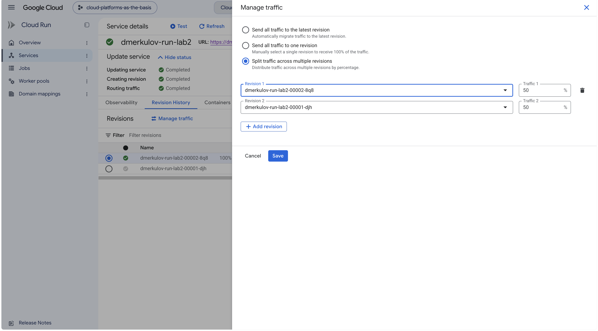

При сохранении получил отказ: `service level max instances must be greater than or equal to the number of targets receiving traffic`.

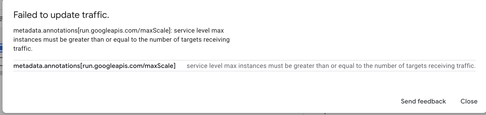

Причина в моих же настройках: я поставил максимум экземпляров 1, а для двух ревизий нужно минимум два, по одному на каждую. Поднял максимум до 2.

После этого распределение сохранилось: по 50% на каждую ревизию.

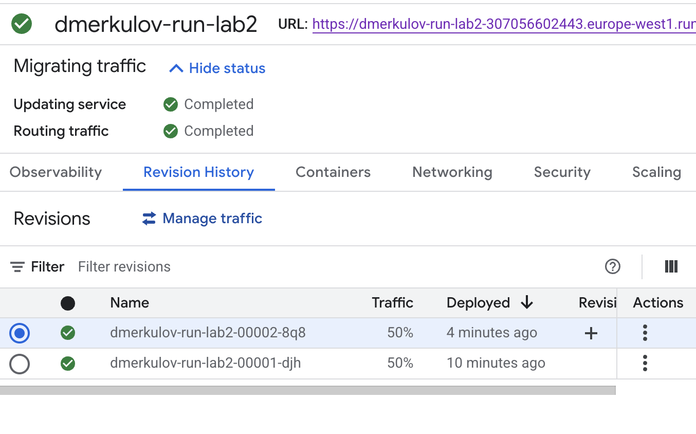

Обновил страницу несколько раз. Внешне ничего не меняется, обе ревизии отдают одну и ту же страницу, но в логах видно, что поднялся второй экземпляр, и запросы обслуживают обе версии.

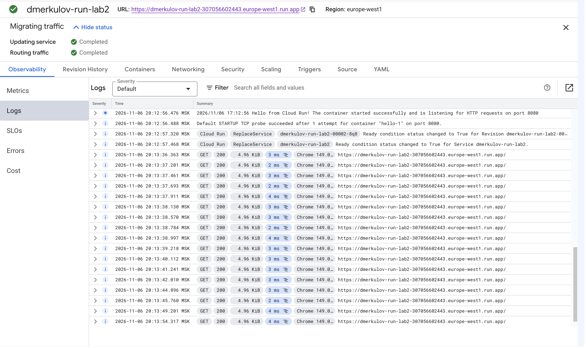

Зачем это нужно на практике: так выкатывают обновления. Новую версию пускают сначала на небольшую долю пользователей, смотрят на ошибки и время ответа, и если все хорошо, постепенно переводят на нее весь трафик. Если плохо, возвращают трафик на старую ревизию одним действием, без пересборки и переразвертывания. Старые ревизии никуда не деваются и остаются доступными для отката.

### 6. Удаление сервиса

Удалил сервис, чтобы не занимать ресурсы проекта.

## Выводы

Разобрался, как работает Cloud Run: отдаешь контейнер, получаешь адрес, а масштабированием занимается платформа.

Две вещи оказались не такими, как я ожидал.

Первое про порт. Я думал, что смена порта сломает сервис, а он продолжил работать, потому что контейнер берет номер порта из переменной окружения, а не из своего кода. Полезно знать на будущее: если упаковывать свое приложение в контейнер для Cloud Run, оно должно читать `PORT`, иначе работать не будет.

Второе про ограничения. Настройка «максимум один экземпляр», которая казалась безобидной экономией, не дала разделить трафик между версиями. Параметры в облаке связаны между собой, и ограничение, поставленное в одном месте, вылезает совсем в другом.

Главное же отличие Cloud Run от виртуальной машины в том, за что платишь. Машина работает всегда, Cloud Run только когда есть запросы. Для сервиса с редкими обращениями разница в счете получается в разы.
