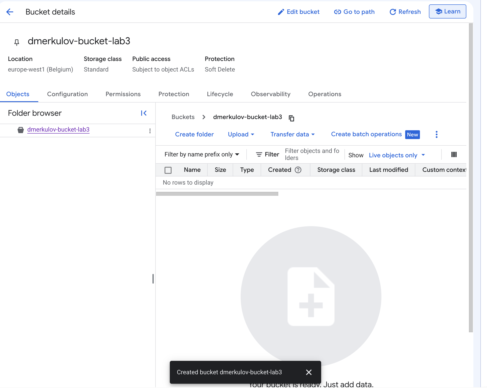
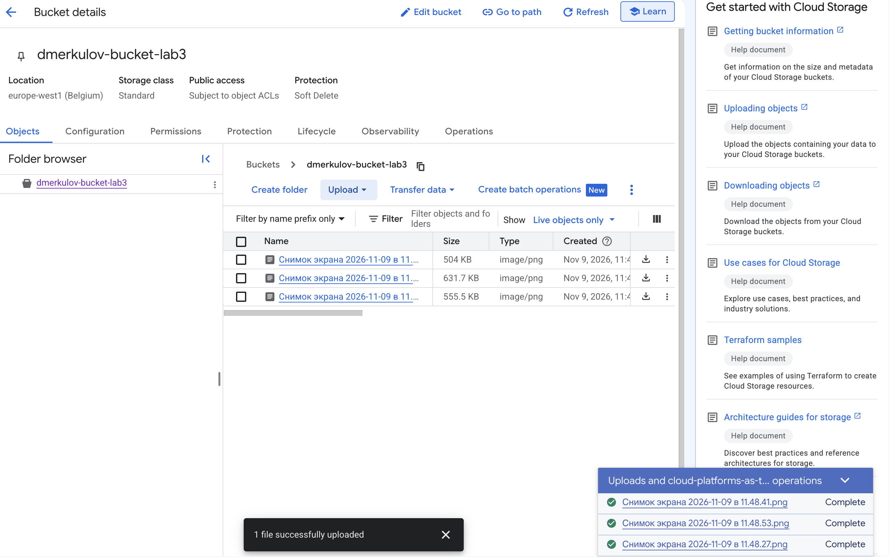
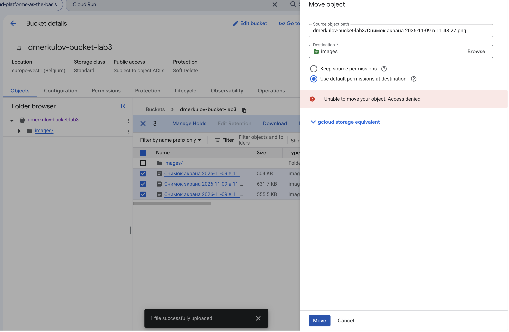
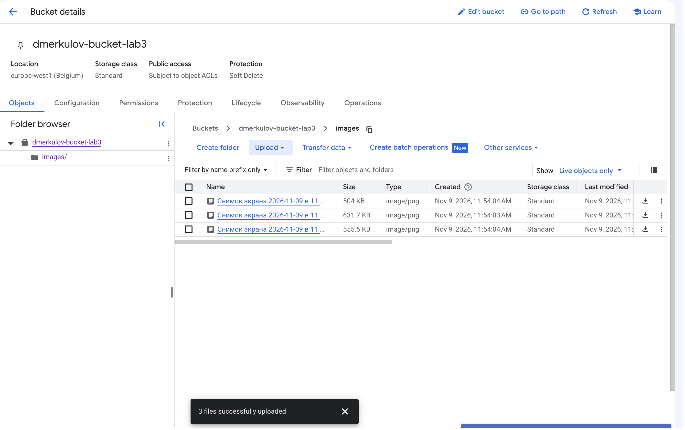
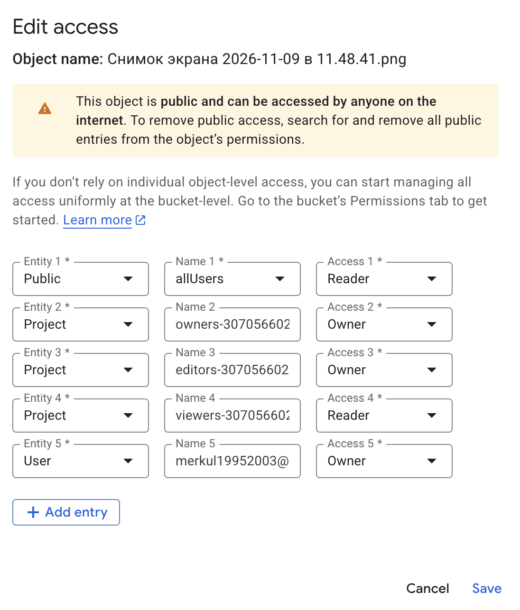
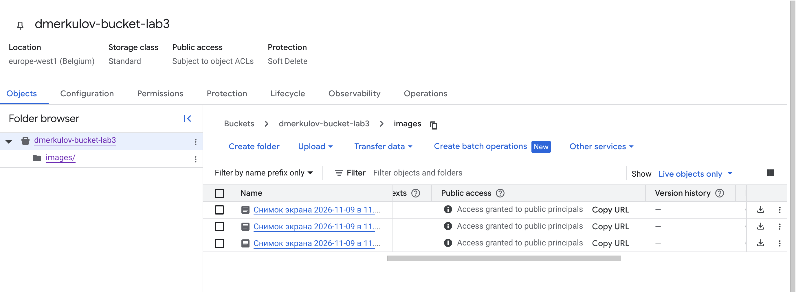
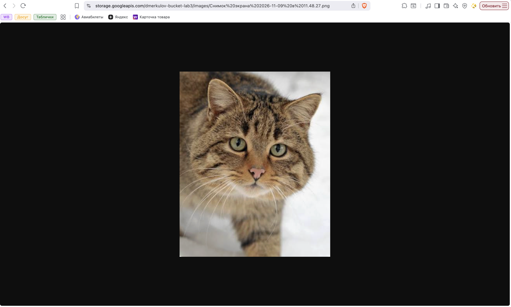
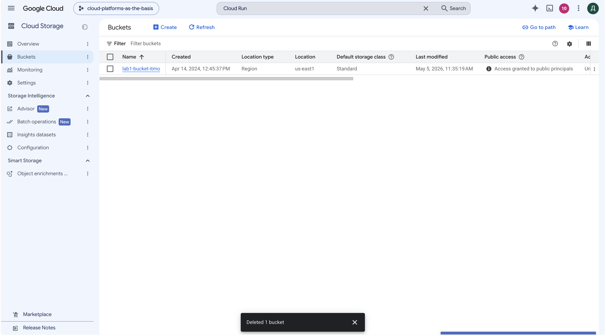

University: [ITMO University](https://itmo.ru/ru/)
Faculty: [FICT](https://fict.itmo.ru)
Course: [Cloud platforms as the basis of technology entrepreneurship](https://github.com/itmo-ict-faculty/cloud-platforms-as-the-basis-of-technology-entrepreneurship)
Year: 2025/2026
Group: U4125
Author: Merkulov Daniil Vyacheslavovich
Lab: Lab3
Date of create: 09.11.2026
Date of finished: [указать после защиты]

## Цель работы

Ознакомиться с основными понятиями и принципами работы облачного хранилища, изучить различные модели хранения данных (блочное, файловое, объектное), познакомиться с основными сервисами и функционалом облачных хранилищ.

## Три модели хранения данных

Перед работой разобрался, чем отличаются модели хранения, потому что от этого зависит, какой сервис выбирать под задачу.

**Блочное хранилище.** Диск разбит на блоки фиксированного размера, и система сама решает, что в них писать. Для программы это выглядит как обычный жесткий диск. Подключается к одной машине, работает быстро. В Google Cloud это Persistent Disk, тот самый диск, который создавался вместе с виртуальной машиной в первой лабораторной. Подходит для баз данных и операционных систем.

**Файловое хранилище.** Привычная структура из папок и файлов, доступная сразу нескольким машинам по сети. В Google Cloud это Filestore. Подходит, когда несколько серверов работают с общими файлами.

**Объектное хранилище.** Это Cloud Storage. Файл кладется в бакет целиком, вместе с метаданными, и получает свой адрес. Папок в привычном смысле нет. Такое хранилище дешевле остальных, объем практически не ограничен, к файлу можно обратиться по обычной ссылке из браузера. Минус в том, что файл нельзя изменить частично, только перезаписать целиком. Подходит для картинок, видео, бэкапов, логов.

## Ход работы

### 1. Создание бакета

Создал бакет `dmerkulov-bucket-lab3`. Имя бакета уникально на весь Google Cloud, а не только внутри проекта, поэтому пришлось добавить фамилию.

Настройки:

- Расположение: **Region**, `europe-west1`
- Класс хранения: **Standard**
- Управление доступом: **Fine-grained**
- Защита от публичного доступа: **отключена**

Про тип доступа отдельно, потому что от него зависело все дальнейшее. Вариантов два:

- **Uniform**: права назначаются на весь бакет сразу, и все объекты внутри живут по одним правилам
- **Fine-grained**: у каждого объекта могут быть свои права

Задание требует открыть доступ к отдельным файлам, поэтому выбрал Fine-grained. Заодно пришлось снять галочку «Prevent public access», иначе Google просто не дал бы поставить публичный доступ, даже если очень хочется.



### 2. Загрузка файлов

Загрузил три изображения в формате PNG через кнопку **Upload files**.



### 3. Папка внутри бакета

Создал папку `images` и попробовал переместить туда файлы. Получил отказ: `Unable to move your object. Access denied`.



Разобрался, почему так. В объектном хранилище перемещения как такового не существует. Папок там тоже нет: то, что показано как папка, это просто часть имени объекта. Файл `images/photo.png` лежит в бакете одним объектом с таким именем, а консоль рисует из этого дерево папок для удобства.

Поэтому «перемещение» внутри бакета это на самом деле две операции: скопировать объект под новым именем и удалить старый. Вторая требует права на удаление, которого у моей учетной записи в учебном проекте не оказалось.

Сделал по-другому: зашел в папку `images` и загрузил файлы сразу туда. Результат тот же, а операция другая, обычная загрузка.



### 4. Публичный доступ

Для каждого файла открыл меню **Edit access** и добавил запись: Entity **Public**, Name **allUsers**, Access **Reader**.

`allUsers` означает вообще любого пользователя интернета, без входа в Google. Reader дает только чтение, то есть скачать файл можно, а изменить или удалить нет.



После сохранения в окне появилось предупреждение «This object is public and can be accessed by anyone on the internet», а в списке файлов в колонке Public access встало «Access granted to public principals».



### 5. Ссылки на файлы

Через меню файла скопировал ссылку вида:

```
https://storage.googleapis.com/dmerkulov-bucket-lab3/images/<имя файла>
```

Открыл ее в режиме инкогнито, то есть без входа в аккаунт Google. Картинка открылась.



Структура ссылки хорошо показывает устройство объектного хранилища: домен сервиса, имя бакета и дальше полное имя объекта вместе с префиксом `images/`. Никакого отдельного «пути к папке» в ней нет, папка это часть имени файла.

### 6. Удаление бакета

Удалил бакет вместе с содержимым.



## Выводы

Разобрался, как устроено объектное хранилище и чем оно отличается от привычного диска.

Главное, что для меня оказалось неочевидным: папок в Cloud Storage нет. Дерево папок в консоли это красивое отображение имен объектов, а не реальная структура. Понял я это не из документации, а когда не сработало перемещение файлов: выяснилось, что перемещение это копирование плюс удаление, и прав на вторую часть у меня не было. Обошел это загрузкой файлов сразу в нужное место.

Второе наблюдение про доступ. Чтобы открыть файл всему интернету, пришлось сделать два шага: при создании бакета отключить защиту от публичного доступа и затем выдать права `allUsers` на каждый файл. Сделано это явно специально: случайно выложить данные в открытый доступ одним кликом не получится.

Любопытно сравнить с первой лабораторной. Там учебный бакет `lab1-bucket-itmo` оказался открыт публично, и я это обнаружил, когда смена роли сервисного аккаунта не закрыла доступ к файлам. Теперь понятно, как такая настройка делается с другой стороны и почему она переживает смену прав у аккаунта: это два независимых уровня доступа.

Для практики вывод простой: под картинки и файлы, которые нужно отдавать пользователям по ссылке, объектное хранилище подходит лучше всего. Оно дешевое, не требует сервера, и ссылка работает сразу.
