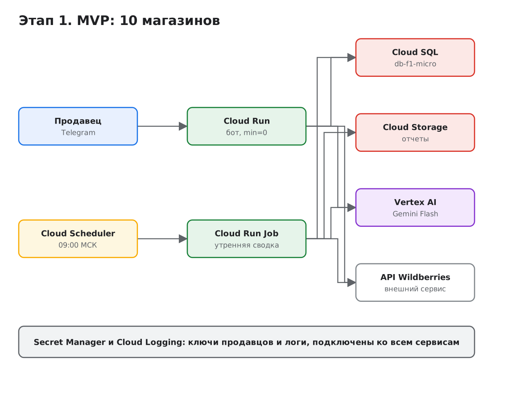
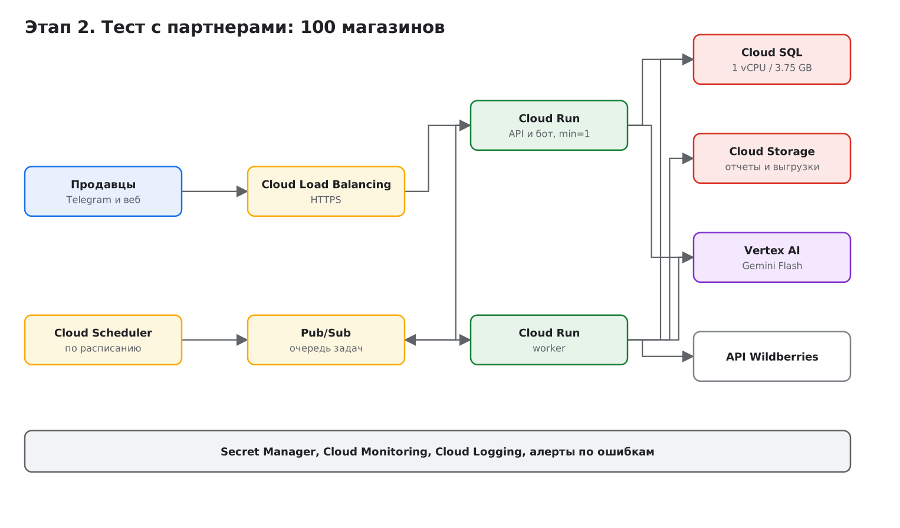
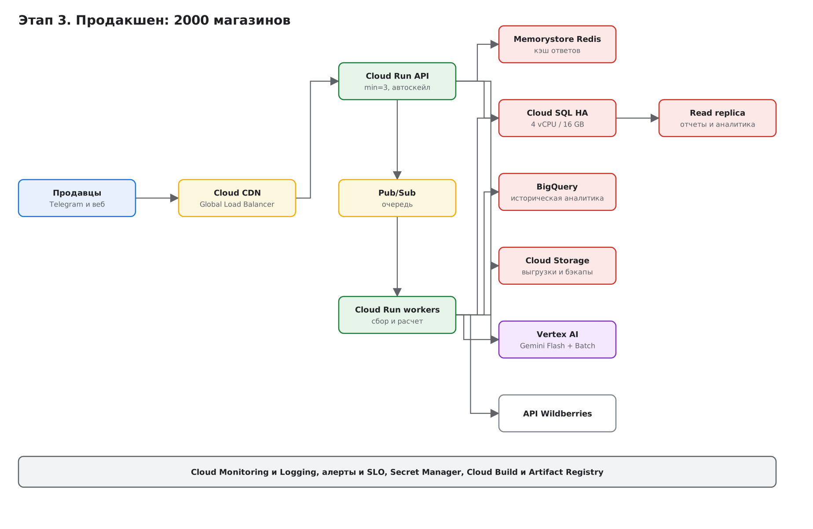

University: [ITMO University](https://itmo.ru/ru/)
Faculty: [FICT](https://fict.itmo.ru)
Course: [Cloud platforms as the basis of technology entrepreneurship](https://github.com/itmo-ict-faculty/cloud-platforms-as-the-basis-of-technology-entrepreneurship)
Year: 2025/2026
Group: U4125
Author: Merkulov Daniil Vyacheslavovich
Lab: Lab4
Date of create: 09.11.2026
Date of finished: [указать после защиты]

## Цель работы

Создать прототип AI-приложения с базовой функциональностью: спроектировать схему инфраструктуры в draw.io, посчитать экономическую модель и обосновать выбор ресурсов для трех состояний проекта.

## Исходные данные о приложении

Проектирую сервис **WB Insight**, AI-ассистент для продавцов Wildberries.

**Что делает приложение.** Продавец подключает свой API-ключ от кабинета Wildberries. Сервис раз в сутки забирает данные магазина (заказы, выкупы, расходы на рекламу, воронку продаж), складывает их у себя и утром присылает сводку за прошедший день. Отдельно работает чат: продавец спрашивает обычным языком «почему на прошлой неделе упали заказы» или «какие карточки тянут вниз конверсию», и ассистент отвечает по его цифрам.

**AI-часть.** Языковая модель используется в двух местах: превращает набор цифр в человеческую сводку с акцентом на то, что изменилось, и отвечает на вопросы в чате по данным магазина. Модель не обучается, используется готовая через API.

**Интерфейсы.** На первом этапе только Telegram-бот, с ростом добавляется веб-кабинет с графиками.

### Три состояния проекта

| Параметр | Этап 1. MVP | Этап 2. Тест с партнерами | Этап 3. Продакшен |
|---|---|---|---|
| Магазинов | 10 | 100 | 2 000 |
| Сводок в день | 10 | 100 | 2 000 |
| Запросов в чат в день | 50 | 1 000 | 20 000 |
| Интерфейс | Telegram | Telegram и веб | Telegram и веб |
| Доступность | как получится | рабочее время | круглосуточно, SLA |
| Кто пользуется | я и знакомые | партнеры, знакомые селлеры | платящие клиенты |

## Схемы инфраструктуры

Схемы сделаны в draw.io, исходный файл со всеми тремя этапами лежит рядом: [infrastructure.drawio](infrastructure.drawio).

### Этап 1. MVP

Минимальный набор, задача которого проверить идею, а не выдержать нагрузку.

| Сервис | Зачем | Почему именно он |
|---|---|---|
| Cloud Run (бот) | обрабатывает сообщения | масштабируется с нуля, в простое не стоит ничего |
| Cloud Run Job | утренняя рассылка | задача запускается раз в сутки, держать для нее сервер бессмысленно |
| Cloud Scheduler | запуск по расписанию | встроенный планировщик, не надо поднимать свой |
| Cloud SQL (db-f1-micro) | данные магазинов и ключи | нужны связи между таблицами и история, минимальная конфигурация стоит копейки |
| Cloud Storage | выгрузки и графики | дешево, отдается по ссылке |
| Vertex AI, Gemini Flash | генерация текста сводок | оплата по токенам, своя модель не нужна |
| Secret Manager | токены и ключи | в коде ключи держать нельзя, это проверено в первой лабораторной |

### Этап 2. Тест с партнерами

Появляются чужие пользователи, значит появляются требования к отзывчивости и к тому, чтобы ничего не терялось.

Что добавилось и зачем:

- **Pub/Sub и отдельный worker.** Сбор данных из Wildberries идет медленно и упирается в лимиты их API. Если делать это в том же сервисе, который отвечает пользователю, бот начнет подвисать. Очередь разделяет быстрые ответы и долгую фоновую работу, а при сбое задача не теряется, а повторяется.
- **min=1 у основного сервиса.** Один экземпляр всегда наготове, чтобы у партнеров не было холодного старта на первом запросе. Это уже не бесплатно, но терпимо.
- **Cloud Load Balancing.** Нужен для веб-кабинета: свой домен, сертификат HTTPS.
- **Cloud SQL 1 vCPU / 3.75 ГБ.** Минимальная конфигурация перестает тянуть: данных в сто раз больше и появились отчеты за период.
- **Мониторинг и алерты.** Пока пользователь был один, о поломке я узнавал сам. Теперь нужно узнавать раньше партнеров.

### Этап 3. Продакшен

Люди платят, значит простой это потерянные деньги и репутация.

Что добавилось:

- **Cloud SQL в режиме High Availability.** База дублируется во второй зоне и переключается автоматически. Это ровно удвоение стоимости базы, и это главная плата за доступность.
- **Read replica.** Тяжелые отчеты и аналитика читают с копии, чтобы не мешать основной базе обслуживать бота.
- **Memorystore Redis.** Кэш ответов. Продавцы часто спрашивают одно и то же, а каждый поход в языковую модель стоит денег. Кэш окупает себя, об этом ниже в расчете.
- **BigQuery.** Историческая аналитика по всем магазинам: считать такое в основной базе тяжело.
- **Cloud CDN.** Статика веб-кабинета раздается из точек ближе к пользователю.
- **min=3 и автомасштабирование.** Запас на случай всплеска и на выкатку новых версий без простоя.

## Экономическая модель

Расчет по официальным ценам Google Cloud на ноябрь 2026 года, регион `europe-west1`. Курс ЦБ РФ на 09.11.2026: **82,14 ₽ за доллар**.

Оговорка по точности: Cloud Run в europe-west1 относится к Tier 1, цены взяты напрямую. По Cloud SQL, Cloud Storage, Memorystore и дискам Google публикует ставки в калькуляторе по регионам, в текстовом виде отдается колонка для us-central1, поэтому по ним возможно расхождение в пределах 10 процентов в большую сторону.

### Этап 1. MVP

| Статья | $/мес | ₽/мес |
|---|---:|---:|
| Cloud Run (бот и джоба, min=0) | 0,00 | 0 |
| Cloud SQL db-f1-micro + 10 ГБ SSD | 9,37 | 769 |
| Cloud Storage, 2 ГБ | 0,04 | 3 |
| Artifact Registry, 1 ГиБ | 0,05 | 4 |
| Secret Manager | 0,00 | 0 |
| Vertex AI, Gemini Flash | 6,08 | 499 |
| Logging и Monitoring | 0,00 | 0 |
| **Итого** | **15,53** | **1 276** |

Cloud Run на этом этапе бесплатен: 36 000 vCPU-секунд в месяц укладываются в бесплатные 180 000. Логи тоже бесплатны, 50 ГиБ в месяц на проект хватает с большим запасом.

### Этап 2. Тест с партнерами

| Статья | $/мес | ₽/мес |
|---|---:|---:|
| Cloud Run API и бот (min=1) | 22,37 | 1 837 |
| Cloud Run worker | 7,16 | 588 |
| Cloud SQL 1 vCPU / 3,75 ГБ + 50 ГБ | 57,81 | 4 749 |
| Cloud Load Balancing | 18,65 | 1 532 |
| Cloud Storage и трафик | 4,60 | 378 |
| Artifact Registry | 0,45 | 37 |
| Vertex AI, Gemini Flash | 105,75 | 8 686 |
| Logging, 60 ГиБ | 5,00 | 411 |
| **Итого** | **221,79** | **18 217** |

### Этап 3. Продакшен

| Статья | $/мес | ₽/мес |
|---|---:|---:|
| Cloud Run API и бот (min=3) | 249,56 | 20 499 |
| Cloud Run workers | 156,67 | 12 869 |
| Cloud SQL 4 vCPU / 16 ГБ, HA + 500 ГБ | 574,71 | 47 206 |
| Memorystore Redis, 4 ГиБ | 143,08 | 11 752 |
| Load Balancing и CDN, 1 ТБ | 26,44 | 2 172 |
| Исходящий трафик, 1 ТБ | 122,88 | 10 093 |
| Cloud Storage, 500 ГБ | 10,00 | 821 |
| Artifact Registry | 1,95 | 160 |
| Vertex AI, Gemini Flash | 2 115,00 | 173 723 |
| Logging, 500 ГиБ | 225,00 | 18 481 |
| **Итого** | **3 625,30** | **297 777** |

### Сводка

| Этап | Магазинов | $/мес | ₽/мес | $ на магазин |
|---|---:|---:|---:|---:|
| 1. MVP | 10 | 15,53 | 1 276 | 1,55 |
| 2. Партнеры | 100 | 221,79 | 18 217 | 2,22 |
| 3. Продакшен | 2 000 | 3 625,30 | 297 777 | 1,81 |

Любопытно, что стоимость на один магазин не падает линейно. На втором этапе она даже выше, чем на первом: появились постоянные расходы (балансировщик, всегда работающий экземпляр, база побольше), а пользователей еще мало, чтобы их размазать. Разделить эти расходы на две тысячи магазинов получается только к третьему этапу.

## Главный вывод расчета: платим за модель, а не за серверы

Доля языковой модели в расходах:

| Этап | Доля Vertex AI в счете |
|---|---:|
| 1. MVP | 39% |
| 2. Партнеры | 48% |
| 3. Продакшен | 58% |

Это переворачивает привычную логику. Обычно при проектировании думают, какой взять сервер и сколько памяти, а здесь на третьем этапе инфраструктура стоит 1 500 долларов, а обращения к модели 2 100. Экономить на процессорах, не трогая модель, бессмысленно.

Отсюда три решения, которые заложены в архитектуру третьего этапа:

**Кэш ответов (Redis).** Продавцы задают похожие вопросы, а сводка за один и тот же день не меняется. Если кэш закрывает хотя бы 40 процентов обращений, экономия около 850 долларов в месяц при стоимости самого Redis 143 доллара. Окупается в шесть раз.

**Пакетная обработка утренних сводок.** Сводки не срочные, их можно считать через Batch tier, который дешевле обычного примерно вдвое.

**Выбор модели под задачу.** Для сводки по шаблону хватает самой дешевой Flash-Lite, более дорогая модель нужна только в чате, где вопрос произвольный.

Суммарно эти три меры дают примерно 2 460 долларов вместо 3 625, то есть минус треть счета.

**Отдельный риск.** Текущие цены Gemini Flash промоакционные и действуют до 31 декабря 2026 года, после чего удваиваются. При тех же объемах третий этап подорожает до 5 740 долларов в месяц, а доля модели вырастет до 74 процентов. В экономической модели продукта это надо закладывать заранее: подписка, рассчитанная по сегодняшним ценам, в январе станет убыточной.

## Почему дешевое решение на старте не всегда оптимально

Методичка отдельно просит подумать об этом, и на моем расчете видно, о чем речь.

Самый дешевый MVP это не Cloud Run, а обычная виртуальная машина e2-micro со SQLite на диске:

| Вариант MVP | $/мес | Что потом |
|---|---:|---|
| e2-micro (Spot) + SQLite | ≈ 10 | переписывать все при росте |
| e2-micro (обычная) + SQLite | ≈ 14 | то же самое |
| Cloud Run + Cloud SQL | ≈ 15,5 | переносится на следующие этапы без переписывания |

Разница в деньгах около пяти долларов в месяц, то есть четыреста рублей. А разница в последствиях большая.

На виртуалке с SQLite я упрусь в потолок сразу на втором этапе: база в одном файле не выдержит параллельных записей от воркеров, машину придется мониторить и обновлять руками, а масштабировать можно только одним способом, вручную взяв машину побольше. Переход на нормальную архитектуру будет означать переписывание работы с данными и переезд, то есть простой в тот самый момент, когда появились первые живые пользователи.

Cloud Run и Cloud SQL дороже на старте, но доживают до третьего этапа без смены технологий: меняются только размер базы, число экземпляров и настройки, а код остается тем же. Пятьсот рублей в месяц это плата за то, чтобы не переписывать проект в момент роста.

При этом обратное тоже верно, и переусердствовать не стоит. Ставить на первом этапе Kubernetes или базу в режиме High Availability было бы ошибкой в другую сторону: только управление кластером GKE стоит 73 доллара в месяц, в пять раз больше, чем весь мой MVP. Правило, к которому я пришел: на старте берутся сервисы, которые дешевы в простое и при этом растут вместе с нагрузкой, а дублирование и запас по мощности добавляются тогда, когда простой начинает стоить денег.

## Вывод

Спроектировал инфраструктуру AI-ассистента для продавцов Wildberries в трех состояниях и посчитал расходы: 1 276 рублей на старте, 18 тысяч на этапе партнеров и около 298 тысяч в месяц в продакшене на две тысячи магазинов.

Главное, что дал расчет, это понимание, где на самом деле деньги. Я ожидал, что основная статья расходов будет база или серверы, а оказалось, что больше половины счета в продакшене занимают обращения к языковой модели. Из-за этого архитектура третьего этапа строится вокруг того, как обратиться к модели пореже: кэш, пакетная обработка, выбор модели под конкретную задачу. Эти решения экономят в разы больше, чем любая оптимизация вычислений.

Второй вывод про выбор на старте. Разница между самым дешевым и разумным вариантом MVP оказалась около четырехсот рублей в месяц, а разница в том, придется ли переписывать проект через полгода, принципиальная. Выбирать нужно не самое дешевое решение, а самое дешевое из тех, что доживут до следующего этапа.
